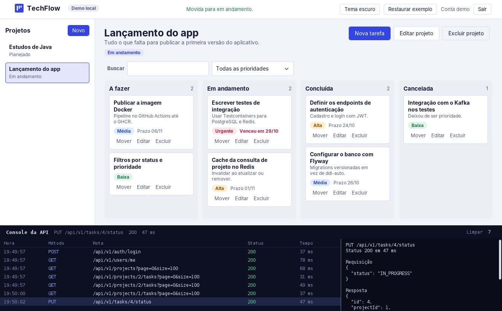
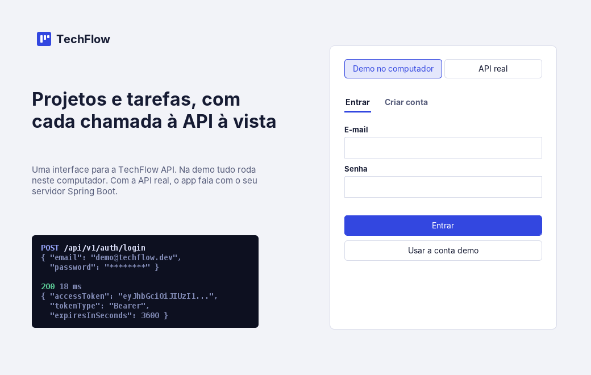
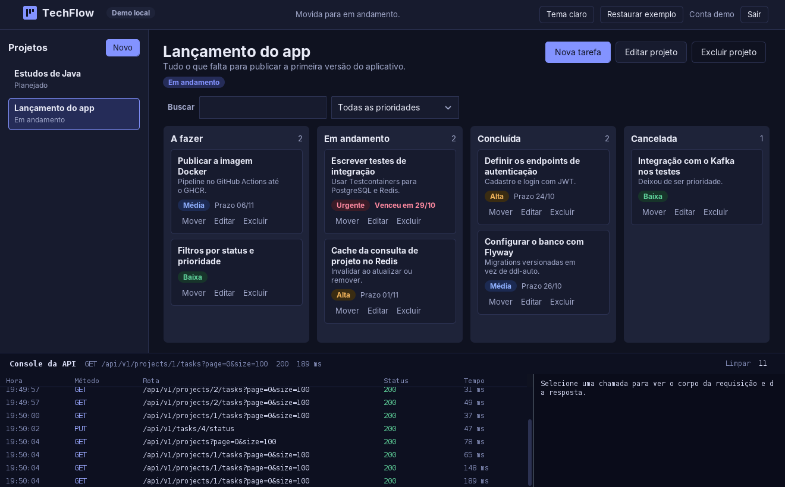
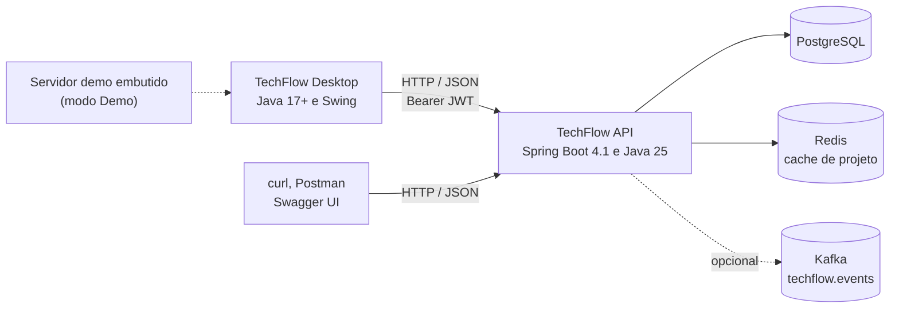
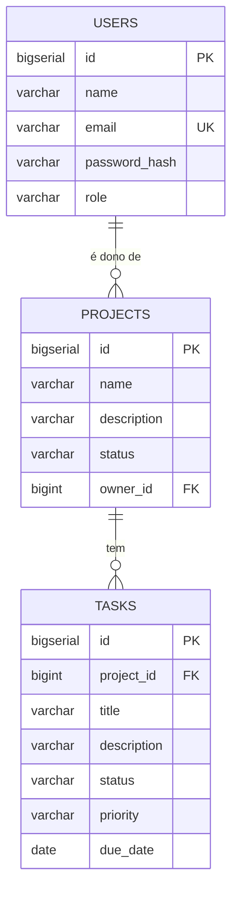

<p align="center">
  
</p>

<h1 align="center">TechFlow<br><sub><sup><sup><sub>Copyright (©) 2026 André Felipe de Barros</sub></sup></sup></sub></h1>

<p align="center">
  API REST para gerenciar projetos e tarefas, com um aplicativo de computador para usá-la. Cada pessoa enxerga apenas os próprios projetos e as tarefas deles: cadastro e login com JWT, projetos com status, tarefas com prioridade, prazo e status, listagens paginadas, cache de consulta no Redis, eventos de tarefa no Kafka (opcional) e o schema do banco versionado com Flyway.<br>
  O <b>TechFlow Desktop</b> (pasta <a href="desktop/"><code>desktop/</code></a>) é um quadro de tarefas em Java e Swing: arraste um cartão para outra coluna e veja, no console do rodapé, a chamada HTTP que o app fez. Ele funciona com o seu servidor Spring Boot ou, sem back-end nenhum, em um modo demo que se comporta como a API.<br>
  Tudo no mesmo repositório, pronto para rodar com Docker Compose, Maven ou um duplo clique.
</p>

<p align="center">
  Java 25 · Spring Boot 4.1 · Spring Security (JWT, HS256) · Spring Data JPA · PostgreSQL · Flyway · Redis · Kafka (opcional) · Swagger / OpenAPI · JUnit 5 e Mockito · Docker Compose · GitHub Actions · App desktop em Java 17+ e Swing
</p>

---

> **Para quem quer só ver funcionando:** abra a [pasta `desktop/`](desktop/), rode `./build.sh` (ou `build.bat` no Windows), abra `dist/TechFlow.jar` e clique em **Usar a conta demo**. Para a API de verdade, rode `docker compose up -d postgres redis` e `./mvnw spring-boot:run`, e abra [http://localhost:8080/swagger-ui.html](http://localhost:8080/swagger-ui.html).

> **Documentação da API:** [`docs/openapi.yaml`](docs/openapi.yaml) traz o contrato completo (rotas, corpos, enums, o formato dos erros e as rotas de administrador), [`docs/postman.json`](docs/postman.json) é uma collection pronta para importar e [`docs/architecture.md`](docs/architecture.md) explica a organização do código.

> **App desktop:** [`desktop/README.md`](desktop/README.md) explica o TechFlow Desktop em detalhe: os dois modos (Demo e API real), o quadro com arrastar e soltar, o console da API e como gerar o `TechFlow.exe` para Windows.

<p align="center">
  
</p>

## Por que criei este projeto

Estou me preparando para começar minha carreira como desenvolvedor Java backend júnior. Percebi que seguir tutoriais isolados não me mostrava como as peças se encaixam num sistema de verdade, então decidi construir um projeto completo e praticar tudo junto: autenticação com JWT, banco relacional com migrations, cache com Redis, mensageria com Kafka, testes e pipeline de CI/CD.

Escolhi gerenciamento de projetos e tarefas porque já usei Trello, Jira e quadros Kanban no dia a dia e queria entender como esse tipo de sistema funciona por dentro, do cadastro do usuário até a mudança de status de uma tarefa.

A ideia nunca foi só "fazer funcionar". Cada decisão técnica abaixo nasceu de uma dúvida que precisei resolver, e o projeto continua evoluindo conforme eu aprendo.

Depois que a API estava de pé, senti falta de ver o sistema funcionando com os meus próprios olhos, e não só em respostas JSON. Por isso criei o **TechFlow Desktop**, um quadro de tarefas que consome a API e mostra cada chamada que faz. Ele também me obrigou a olhar a API como quem a usa: foi assim que apareceram os formatos de erro, a paginação e o isolamento por usuário vistos de fora.

## O que eu queria aprender

- Isolar dados por usuário, garantindo que cada um veja apenas o que é seu
- Organizar o código em camadas (application, domain, infrastructure, interfaces)
- Usar cache onde faz sentido e entender o custo de invalidá-lo
- Publicar eventos com Kafka sem tornar a aplicação dependente dele
- Montar um pipeline de CI/CD de ponta a ponta, do teste até a imagem Docker
- Consumir a própria API em um cliente de verdade e descobrir o que falta no contrato

## O que o TechFlow faz

- **Autenticação:** cadastro e login devolvem um token JWT (HS256) com o e-mail, o papel e a validade. A senha é guardada com BCrypt e o servidor não guarda sessão.
- **Isolamento por usuário:** projetos e tarefas só aparecem para o dono. Quem pede um recurso de outra pessoa, mesmo conhecendo o ID, recebe `404`, como se ele não existisse.
- **Projetos:** nome, descrição e status (`PLANNED`, `IN_PROGRESS`, `COMPLETED` ou `ARCHIVED`), com criar, listar com paginação, consultar, atualizar e remover.
- **Tarefas:** título, descrição, prioridade (`LOW`, `MEDIUM`, `HIGH` ou `URGENT`), prazo e status (`TODO`, `IN_PROGRESS`, `DONE` ou `CANCELED`). Toda tarefa nasce em `TODO`, e o status muda por uma rota própria.
- **Validação e erros padronizados:** os limites de tamanho e os campos obrigatórios vêm dos próprios `record`s, e todo erro de negócio sai no mesmo formato (`timestamp`, `status`, `error`, `message`, `path`).
- **Cache:** a consulta de um projeto fica no Redis e é invalidada quando um projeto é atualizado ou removido.
- **Eventos:** criar uma tarefa publica `TaskCreated` e mudar o status publica `TaskStatusChanged` no tópico `techflow.events` do Kafka. Com o Kafka desligado (o padrão), a aplicação usa um publicador vazio e nada muda para quem chama a API.
- **Banco versionado:** o schema nasce de uma migration do Flyway e o Hibernate só valida (`ddl-auto: validate`).
- **Administração:** quem tem o papel `ADMIN` lista os usuários e vê o total de cadastros.
- **Observabilidade e documentação viva:** Swagger UI, contrato OpenAPI, endpoint de saúde e métricas do Actuator.
- **Pipeline:** testes, empacotamento, imagem Docker no GitHub Container Registry e um deploy por SSH que só roda manualmente.
- **App desktop:** quadro de tarefas com arrastar e soltar, console de requisições, tema claro e escuro e modo demo, em [`desktop/`](desktop/).

## Como rodar

Há três jeitos de usar o TechFlow.

### 1. API local (desenvolvimento)

Requisitos: JDK 25, Docker e Git.

```bash
docker compose up -d postgres redis
./mvnw spring-boot:run
```

Para habilitar o Kafka:

```bash
docker compose --profile messaging up -d postgres redis kafka
APP_KAFKA_ENABLED=true ./mvnw spring-boot:run
```

No Windows, use `./mvnw.cmd spring-boot:run`. O script [`scripts/run-local.sh`](scripts/run-local.sh) faz o primeiro caso de uma vez.

| Endereço | O que é |
|---|---|
| http://localhost:8080 | A API |
| http://localhost:8080/swagger-ui.html | Swagger UI |
| http://localhost:8080/v3/api-docs | O contrato gerado pelo springdoc |
| http://localhost:8080/actuator/health | Saúde da aplicação (aberto, sem token) |

### 2. API em contêiner (produção)

O workflow de CI publica a imagem em `ghcr.io/andrefelipebarros/techflow-api`. O [`docker-compose.prod.yml`](docker-compose.prod.yml) sobe a aplicação com PostgreSQL e Redis e **exige** as variáveis `GHCR_IMAGE`, `POSTGRES_PASSWORD` e `JWT_SECRET`, para não subir por engano com valores de exemplo:

```bash
export GHCR_IMAGE=ghcr.io/andrefelipebarros/techflow-api:latest
export POSTGRES_PASSWORD='uma-senha-forte'
export JWT_SECRET='um-segredo-aleatorio-com-pelo-menos-32-caracteres'
docker compose -f docker-compose.prod.yml up -d
```

### 3. App desktop

Requisito: Java 17 ou mais novo, tanto para o `.jar` quanto para o [`desktop/TechFlow.exe`](desktop/TechFlow.exe) que já vem no repositório (dois cliques no Windows). A versão com o Java embutido sai do workflow do GitHub Actions.

```bash
cd desktop
./build.sh
java -jar dist/TechFlow.jar
```

Na tela de entrada, escolha **Demo no computador** (sem back-end) ou **API real** (informe `http://localhost:8080`). O passo a passo do `.exe` está em [`desktop/README.md`](desktop/README.md#gerar-o-techflowexe).

## App desktop

<p align="center">
  
  
</p>

| Recurso | Como funciona |
|---|---|
| **Dois modos** | **Demo** usa um servidor embutido que imita a API (mesmos formatos, mesmas validações, isolamento por usuário). **API real** usa `java.net.http` contra o endereço informado. O botão **Testar** consulta `/actuator/health` |
| **Quadro** | Quatro colunas, uma por status. Arrastar um cartão chama `PUT /api/v1/tasks/{id}/status`; se a API recusar, o cartão volta ao lugar |
| **Console da API** | Uma linha por chamada, com método, rota, status e tempo. Clicar mostra a requisição e a resposta em JSON, com senhas e tokens protegidos |
| **Projetos e tarefas** | Criar, editar e excluir, com busca por texto e filtro por prioridade |
| **Sem dependências** | Só o JDK: Swing, `java.net.http` e um leitor de JSON próprio |

Por ser um aplicativo de computador, ele **não passa pelo navegador** e por isso não depende de CORS: a API continua exatamente como está.

## Arquitetura



| Parte | Linguagem | Responsabilidade |
|---|---|---|
| `src/main/java/.../interfaces/rest` | Java | Controllers REST (`AuthController`, `UserController`, `ProjectController`, `TaskController`, `AdminController`) e o `ApiExceptionHandler`, que traduz exceções em respostas padronizadas |
| `src/main/java/.../application` | Java | Casos de uso: `AuthService`, `UserService`, `ProjectService` e `TaskService`, com os DTOs de entrada e saída como `record`s |
| `src/main/java/.../domain` | Java | Entidades (`User`, `Project`, `Task`), enums (`Role`, `ProjectStatus`, `TaskStatus`, `Priority`) e os contratos dos repositórios |
| `src/main/java/.../infrastructure` | Java | Segurança (`SecurityConfig`, `JwtService`, `CurrentUser`), cache (`CacheConfig`) e mensageria (`TaskEventPublisher`, com as versões Kafka e vazia) |
| `src/main/resources/db/migration` | SQL | Migrations do Flyway. Hoje: `V1__create_schema.sql` |
| `desktop/` | Java | App de computador: modelos, camada de rede (HTTP real e demo), interface Swing, testes de fumaça e `TechFlow.exe` pronto, fonte do lançador em Go e scripts do `.exe` |
| `docs/` | YAML, JSON, Markdown | Contrato OpenAPI, collection do Postman e documento de arquitetura |
| `.github/workflows/` | YAML | CI/CD da API, CI do app desktop e geração do `.exe` no Windows |

### Como uma requisição é tratada

1. O Spring Security valida o token JWT (assinatura HS256, emissor e validade) e monta o usuário a partir do e-mail (`sub`) e dos papéis (`roles`).
2. O controller recebe o corpo e o `@Valid` confere os limites do `record`.
3. O serviço pega o usuário logado por `CurrentUser` e busca o recurso **junto com o dono** (`findByIdAndOwnerId`, `findByIdAndProjectOwnerId`). Se não for dele, a busca volta vazia e a resposta é `404`.
4. Mudanças de tarefa publicam um evento. A consulta de projeto passa pelo cache.
5. Qualquer exceção cai no `ApiExceptionHandler`, que devolve o corpo de erro padrão.

## Usando a API

O fluxo completo, do cadastro à mudança de status. Troque `$TOKEN` pelo `accessToken` recebido.

```bash
# 1. Cadastro (já devolve o token)
curl -X POST http://localhost:8080/api/v1/auth/register \
  -H 'Content-Type: application/json' \
  -d '{"name": "Alice Silva", "email": "alice@example.com", "password": "Senha@123"}'
```

```json
{ "accessToken": "eyJhbGciOiJIUzI1NiJ9...", "tokenType": "Bearer", "expiresInSeconds": 3600 }
```

```bash
export TOKEN='cole-o-accessToken-aqui'

# 2. Criar um projeto
curl -X POST http://localhost:8080/api/v1/projects \
  -H "Authorization: Bearer $TOKEN" -H 'Content-Type: application/json' \
  -d '{"name": "TechFlow", "description": "Projeto de portfólio", "status": "PLANNED"}'

# 3. Criar uma tarefa no projeto 1
curl -X POST http://localhost:8080/api/v1/projects/1/tasks \
  -H "Authorization: Bearer $TOKEN" -H 'Content-Type: application/json' \
  -d '{"title": "Implementar autenticação", "priority": "HIGH", "dueDate": "2026-12-15"}'

# 4. Mover a tarefa para Em andamento
curl -X PUT http://localhost:8080/api/v1/tasks/1/status \
  -H "Authorization: Bearer $TOKEN" -H 'Content-Type: application/json' \
  -d '{"status": "IN_PROGRESS"}'

# 5. Listar as tarefas do projeto, 20 por página
curl "http://localhost:8080/api/v1/projects/1/tasks?page=0&size=20" \
  -H "Authorization: Bearer $TOKEN"
```

Uma tarefa devolvida pela API (campos vazios não aparecem, por causa de `default-property-inclusion: non_null`):

```json
{
  "id": 1,
  "projectId": 1,
  "title": "Implementar autenticação",
  "status": "IN_PROGRESS",
  "priority": "HIGH",
  "dueDate": "2026-12-15",
  "createdAt": "2026-11-03T14:42:10.123-03:00"
}
```

### Endpoints

| Método | Rota | Descrição | Acesso |
|--------|------|-----------|--------|
| POST | `/api/v1/auth/register` | Cadastro, devolve o token | Público |
| POST | `/api/v1/auth/login` | Login, devolve o token | Público |
| GET | `/api/v1/users/me` | Usuário logado | Token |
| POST | `/api/v1/projects` | Criar projeto | Token |
| GET | `/api/v1/projects` | Listar projetos do usuário (paginado) | Token |
| GET | `/api/v1/projects/{id}` | Consultar projeto (com cache) | Token |
| PUT | `/api/v1/projects/{id}` | Atualizar projeto | Token |
| DELETE | `/api/v1/projects/{id}` | Remover projeto e as tarefas dele | Token |
| POST | `/api/v1/projects/{projectId}/tasks` | Criar tarefa no projeto | Token |
| GET | `/api/v1/projects/{projectId}/tasks` | Listar tarefas do projeto (paginado) | Token |
| GET | `/api/v1/tasks/{taskId}` | Consultar tarefa | Token |
| PUT | `/api/v1/tasks/{taskId}` | Atualizar tarefa | Token |
| PUT | `/api/v1/tasks/{taskId}/status` | Alterar status | Token |
| DELETE | `/api/v1/tasks/{taskId}` | Remover tarefa | Token |
| GET | `/api/v1/admin/users` | Listar todos os usuários (paginado) | `ADMIN` |
| GET | `/api/v1/admin/summary` | Total de usuários | `ADMIN` |
| GET | `/actuator/health` | Saúde da aplicação | Público |

As listagens aceitam `page` (a partir de 0), `size` e `sort`, e respondem com a página do Spring Data: `content`, `totalElements`, `totalPages`, `number` e `size`.

### Limites dos campos

| Campo | Regra |
|---|---|
| `name` do usuário | Obrigatório, até 120 caracteres |
| `email` | Obrigatório, formato de e-mail, até 180 caracteres, único (sem diferenciar maiúsculas) |
| `password` | Obrigatória, de 8 a 72 caracteres |
| `name` do projeto | Obrigatório, até 150 caracteres |
| `description` do projeto | Opcional, até 1000 caracteres |
| `title` da tarefa | Obrigatório, até 180 caracteres |
| `description` da tarefa | Opcional, até 2000 caracteres |
| `priority` e `status` | Precisam ser um dos valores dos enums |
| `dueDate` | Opcional, no formato `AAAA-MM-DD` |

### Erros

Os erros de negócio saem sempre neste formato:

```json
{
  "timestamp": "2026-11-03T14:42:10.123-03:00",
  "status": 404,
  "error": "Not Found",
  "message": "Projeto não encontrado",
  "path": "/api/v1/projects/99"
}
```

| Status | Quando acontece | `message` |
|---|---|---|
| `400` | Corpo inválido: lista os campos, como `title: não deve estar em branco; priority: não deve ser nulo` | Os campos e as regras que falharam |
| `400` | E-mail já cadastrado | `E-mail já cadastrado` |
| `401` | Senha ou e-mail errados no login | `Credenciais inválidas` |
| `401` | Token ausente, inválido ou vencido | Resposta do Spring Security, sem o corpo padrão |
| `403` | Rota de administrador sem o papel `ADMIN` | `Acesso negado` |
| `404` | Recurso inexistente **ou de outro usuário** | `Projeto não encontrado` ou `Tarefa não encontrada` |
| `500` | Erro inesperado (o detalhe vai só para o log) | `Erro interno inesperado` |

### Tornando uma conta ADMIN

Não existe rota para isso, de propósito. Depois de cadastrar a conta, rode o script [`scripts/create-admin.sql`](scripts/create-admin.sql) no banco, trocando o e-mail:

```sql
UPDATE users SET role = 'ADMIN' WHERE email = 'alice@example.com';
```

Faça login de novo: o papel vai dentro do token e só muda quando um token novo é emitido.

## Configuração

A aplicação lê tudo de variáveis de ambiente, com valores padrão pensados para o desenvolvimento local.

| Variável | Padrão | Para quê |
|---|---|---|
| `POSTGRES_HOST` | `localhost` | Servidor do PostgreSQL |
| `POSTGRES_PORT` | `5432` | Porta do PostgreSQL |
| `POSTGRES_DB` | `techflow` | Nome do banco |
| `POSTGRES_USER` | `techflow` | Usuário do banco |
| `POSTGRES_PASSWORD` | `techflow` | Senha do banco (**obrigatória** em produção) |
| `REDIS_HOST` | `localhost` | Servidor do Redis |
| `REDIS_PORT` | `6379` | Porta do Redis |
| `JWT_SECRET` | valor de exemplo | Chave HS256 de pelo menos 32 caracteres (**obrigatória** em produção) |
| `JWT_ISSUER` | `techflow-api` | Emissor (`iss`) dos tokens |
| `JWT_EXPIRATION_MINUTES` | `60` | Validade do token |
| `APP_KAFKA_ENABLED` | `false` | Liga a publicação de eventos |
| `KAFKA_BOOTSTRAP_SERVERS` | `localhost:9092` | Servidores do Kafka |

> **Atenção:** o valor padrão de `JWT_SECRET` existe só para facilitar o desenvolvimento. Quem souber esse texto consegue assinar tokens válidos, então **nunca** use o padrão em um servidor acessível pela internet. O `docker-compose.prod.yml` já recusa subir sem a variável.

Outras escolhas do `application.yml`: threads virtuais ligadas, encerramento gracioso, `ddl-auto: validate`, e o Actuator expondo `health`, `info` e `metrics`, com só o `health` aberto sem token.

## Banco de dados

O schema vem da migration [`V1__create_schema.sql`](src/main/resources/db/migration/V1__create_schema.sql). O Hibernate apenas **confere** se as entidades batem com as tabelas e não cria nada.



| Tabela | Campos principais | Observações |
|---|---|---|
| `users` | `name` (120), `email` (180, único), `password_hash` (255), `role` (30, padrão `USER`) | A senha nunca é guardada em texto |
| `projects` | `name` (150), `description` (1000), `status` (30), `owner_id` | `owner_id` aponta para `users` |
| `tasks` | `title` (180), `description` (2000), `status`, `priority`, `due_date`, `project_id` | `ON DELETE CASCADE`: remover o projeto remove as tarefas |

Todas as tabelas têm `id` sequencial e `created_at` e `updated_at` em `TIMESTAMPTZ`. Índices: `idx_projects_owner_id`, `idx_tasks_project_id`, `idx_tasks_status` e `idx_users_email`.

Para mudar o schema, crie uma nova migration (`V2__descricao.sql`) e **nunca** edite a `V1` depois de aplicada.

## Cache e eventos

**Cache (Redis).** Só a consulta de um projeto por ID é cacheada, no cache `projects`, com a chave `id:ownerId` (o dono entra na chave para um usuário nunca receber o projeto de outro). Atualizar ou remover um projeto limpa o cache inteiro, uma escolha simples e segura em vez de invalidar entrada por entrada. O `ProjectResponse` é `Serializable` por esse motivo.

**Eventos (Kafka).** Com `APP_KAFKA_ENABLED=true`, o tópico `techflow.events` é criado (3 partições, 1 réplica) e cada evento sai assim:

```json
{
  "eventType": "TaskStatusChanged",
  "taskId": 1,
  "projectId": 1,
  "title": "Implementar autenticação",
  "status": "IN_PROGRESS",
  "occurredAt": "2026-11-03T14:42:10.123-03:00"
}
```

| `eventType` | Quando |
|---|---|
| `TaskCreated` | Uma tarefa é criada |
| `TaskStatusChanged` | O status de uma tarefa muda pela rota `/status` |

## Segurança

| Medida | Como está feita |
|---|---|
| Autenticação | Spring Security como *resource server* JWT. Token HS256 com `iss`, `sub` (e-mail), `iat`, `exp` e `roles` |
| Senhas | `BCryptPasswordEncoder`; só o hash vai para o banco |
| Sessão | Sem estado (`STATELESS`). Como não há cookie de sessão, o CSRF fica desligado |
| Autorização | Todas as rotas exigem token, menos `/api/v1/auth/**`, o Swagger, `/v3/api-docs/**` e `/actuator/health/**`. Rotas de administrador usam `@PreAuthorize("hasRole('ADMIN')")` |
| Isolamento | Toda consulta de projeto e tarefa filtra pelo dono; recurso alheio vira `404`, sem revelar que existe |
| Erros | `500` nunca devolve a mensagem da exceção; o detalhe vai só para o log |
| Segredos | `JWT_SECRET` e a senha do banco vêm do ambiente; o compose de produção recusa subir sem eles |
| Entrada | Validação de tamanho e formato nos `record`s, antes de chegar ao serviço |

Pontos que ainda não estão cobertos (veja o [Roadmap](#roadmap)): limite de tentativas de login, renovação de token (*refresh*) e revogação antes do vencimento.

## Desenvolvimento e testes

```bash
./mvnw test                    # testes da API
cd desktop && ./build.sh test  # compila o app desktop e roda os testes de fumaça
```

| Onde | O que existe |
|---|---|
| `AuthServiceTest` | Cadastro com senha em hash e autenticação antes de emitir o token |
| `TaskServiceTest` | Criar tarefa em projeto próprio, recusar projeto alheio e listar com paginação |
| `TaskControllerTest` | `@WebMvcTest`: a tarefa sai como JSON |
| `desktop/tests/SmokeTest.java` | 16 verificações do servidor demo e da camada de rede: login, 400, 401 e 404, isolamento por usuário e o console |

Os testes da API usam H2 em memória (`src/test/resources/application.yml`). O que falta, e está no roadmap, é testar a integração real com PostgreSQL e Redis usando Testcontainers.

### CI/CD

| Workflow | Quando roda | O que faz |
|---|---|---|
| [`ci-cd.yml`](.github/workflows/ci-cd.yml) | Push na `main`, tags `v*` e pull requests | Valida, testa e empacota com Maven, guarda o JAR, publica a imagem no GHCR (fora de pull requests) e, manualmente com `DEPLOY_ENABLED=true`, faz o deploy por SSH |
| [`desktop-ci.yml`](.github/workflows/desktop-ci.yml) | Mudanças em `desktop/` | Compila o app e roda os testes de fumaça |
| [`desktop-windows-exe.yml`](.github/workflows/desktop-windows-exe.yml) | Manual ou tag `desktop-v*` | Gera o `TechFlow.exe` com o Java embutido (sem precisar instalar o Java) num runner Windows e anexa à release |

O [Dependabot](.github/dependabot.yml) cuida das atualizações de dependências.

## Solução de problemas

| Sintoma | Causa provável | O que fazer |
|---|---|---|
| A API não sobe e reclama de conexão | PostgreSQL ou Redis parados | `docker compose up -d postgres redis` e confira com `docker compose ps` |
| `Port 8080 was already in use` | Outra aplicação usa a porta | Pare a outra aplicação ou rode com `SERVER_PORT=8081` |
| `401` em todas as rotas | Token ausente, errado ou vencido | Faça login de novo e envie `Authorization: Bearer <token>` |
| `404` em um projeto que existe | O projeto é de outra conta | É o isolamento por usuário funcionando: entre com a conta dona |
| `403` nas rotas `/admin` | A conta não é `ADMIN`, ou o token é anterior à promoção | Rode o `create-admin.sql` e faça login de novo |
| Erro `Schema-validation` ao subir | O banco tem um schema diferente das entidades | Use um banco novo ou crie uma migration; o Hibernate só valida |
| O app desktop diz "Não foi possível conectar" | API desligada ou endereço errado | Confira o endereço, use **Testar** e veja se `/actuator/health` responde |
| O Windows avisa sobre "app desconhecido" ao abrir o `TechFlow.exe` | O executável não tem assinatura digital | Clique em **Mais informações** e depois em **Executar assim mesmo** |
| O app desktop não abre com dois cliques no `.jar` | Java ausente ou anterior ao 17 | Instale o JDK 17 ou mais novo, ou use o `TechFlow.exe` |

## Decisões e desafios

**Decisões**

- **Kafka opcional:** quis que qualquer pessoa conseguisse rodar o projeto só com PostgreSQL e Redis. Por isso a publicação de eventos fica desligada por padrão e é ativada com `APP_KAFKA_ENABLED=true`.
- **Cache só na consulta de projeto:** é a leitura mais repetida, então é onde o ganho é mais claro. Cachear tudo aumentaria a complexidade de invalidação sem benefício proporcional.
- **Flyway em vez de deixar o Hibernate criar as tabelas:** o schema fica versionado e reproduzível, como seria num ambiente real.
- **Arquitetura em camadas:** separar casos de uso, domínio, infraestrutura e controllers deixa o código mais fácil de testar e de evoluir.
- **Deploy manual e protegido por variável:** o job de deploy só roda quando eu disparo e com `DEPLOY_ENABLED=true`, para evitar publicação acidental.
- **App desktop no mesmo repositório:** a API e o cliente que a consome evoluem juntos. Quando um endpoint muda, o contrato em `docs/openapi.yaml` e o cliente em `desktop/` mudam no mesmo pull request.
- **Cliente desktop em vez de web:** um app de computador fala HTTP direto, sem passar pelo navegador, então a API não precisou de CORS. E o modo demo permite mostrar o projeto sem montar PostgreSQL, Redis e Spring.

**Desafios**

- **Isolamento por usuário:** garantir que ninguém acesse projetos ou tarefas de outra pessoa, mesmo conhecendo o ID, exigiu validar o dono do recurso em cada operação.
- **Spring Security como resource server com JWT (HS256):** entender o fluxo de validação do token e como o usuário autenticado chega até os casos de uso.
- **Coerência do cache:** definir quando invalidar a consulta de projeto ao atualizar ou remover.
- **Ambiente local reproduzível:** fazer PostgreSQL, Redis e Kafka subirem com Docker Compose, com o Kafka em um profile separado.
- **Fazer o cliente se comportar como a API:** o servidor demo do app precisou repetir validações, formatos de erro e paginação. O contrato OpenAPI virou a fonte da verdade para os dois lados.

**O que faria diferente hoje:** começaria com Testcontainers desde o primeiro dia, para testar a integração com PostgreSQL e Redis em vez de depender só de testes unitários.

## Estrutura

```text
.
├── src/main/java/com/alipe/techflow
│   ├── application      casos de uso (auth, project, task)
│   ├── domain           entidades, enums e repositórios
│   ├── infrastructure   segurança, cache e mensageria
│   └── interfaces/rest  controllers e tratamento de erros
├── src/main/resources
│   ├── application.yml  configuração por variáveis de ambiente
│   └── db/migration     migrations do Flyway
├── src/test             testes da API (JUnit 5, Mockito e H2)
├── desktop              TechFlow Desktop (Java e Swing), com README próprio
│   ├── src              código do app
│   ├── tests            testes de fumaça
│   ├── TechFlow.exe     lançador pronto para Windows
│   ├── launcher         fonte em Go do lançador
│   ├── packaging        ícone e scripts do .exe com Java embutido
│   └── docs/images      imagens dos READMEs
├── docs                 openapi.yaml, postman.json e architecture.md
├── scripts              run-local.sh e create-admin.sql
├── .github              workflows e Dependabot
├── Dockerfile           imagem da API
├── docker-compose.yml       PostgreSQL, Redis e Kafka (profile messaging)
└── docker-compose.prod.yml  API, PostgreSQL e Redis para produção
```

## Roadmap

- [x] Autenticação com JWT e controle de acesso por usuário
- [x] CRUD de projetos e tarefas com paginação
- [x] Cache com Redis e eventos opcionais com Kafka
- [x] Pipeline de CI/CD com GitHub Actions
- [x] Contrato OpenAPI com rotas de administrador, erros e schemas de resposta
- [x] App desktop com quadro de tarefas, console de requisições e modo demo
- [ ] Testes de integração com Testcontainers (PostgreSQL e Redis)
- [ ] Consumidor dos eventos de tarefa publicados no Kafka
- [ ] Filtros de listagem por status e prioridade (o app desktop já filtra por prioridade no próprio cliente)
- [ ] Limite de tentativas de login e renovação de token
- [ ] Telas de administração no app desktop
- [ ] Cobertura de testes dos controllers de projeto e administração

## Componentes de terceiros

| Componente | Uso | Licença |
|---|---|---|
| Spring Boot 4.1 (Web MVC, Security, Data JPA, Validation, Cache, Actuator, Kafka) | Base da API | Apache 2.0 |
| springdoc-openapi 3.1 | Swagger UI e `/v3/api-docs` | Apache 2.0 |
| Flyway | Migrations do banco | Apache 2.0 |
| Driver JDBC do PostgreSQL | Acesso ao banco | BSD 2-Clause |
| H2 | Banco em memória dos testes | MPL 2.0 ou EPL 1.0 |
| Apache Kafka (cliente) | Publicação de eventos | Apache 2.0 |
| Imagens oficiais `postgres`, `redis` e `apache/kafka` | Ambiente local com Docker Compose | Conforme cada projeto |

O app desktop **não usa nenhuma biblioteca externa**: só o JDK.

## Autor

Feito por André Felipe de Barros.

GitHub: [andrefelipebarros](https://github.com/andrefelipebarros)

## Licença

Distribuído sob a licença MIT. O texto completo está em [`LICENSE`](LICENSE).
