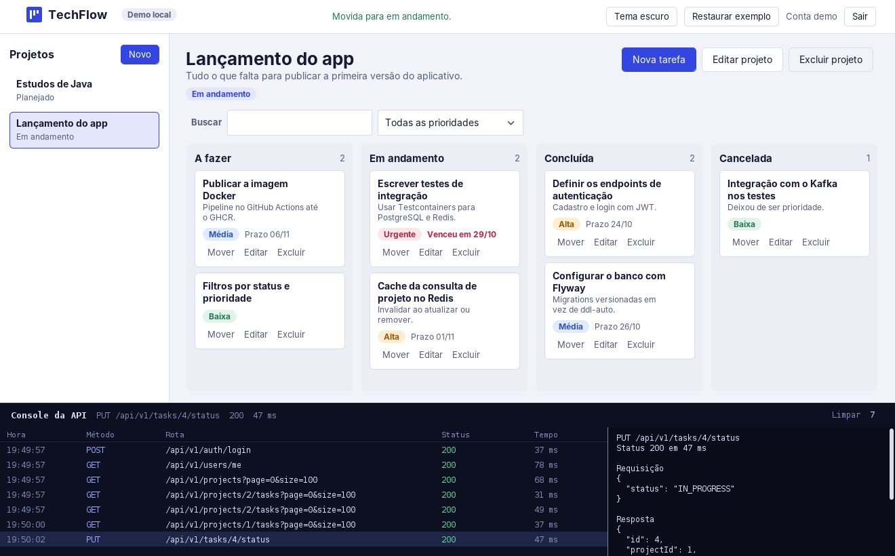
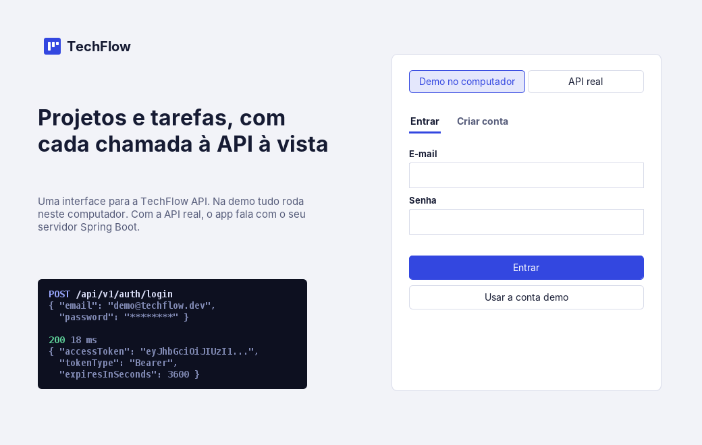

<p align="center">
  
</p>

<h1 align="center">TechFlow Desktop<br><sub><sup><sup><sub>Copyright (©) 2026 André Felipe de Barros</sub></sup></sup></sub></h1>

<p align="center">
  Aplicativo de computador para a <a href="../README.md">TechFlow API</a>, que fica no mesmo repositório (esta pasta é o <code>desktop/</code>): cadastre projetos, organize tarefas em um quadro com uma coluna por status e arraste os cartões de uma coluna para outra.<br>
  Um console fixo no rodapé mostra cada chamada HTTP que o app faz (método, rota, status, tempo e os corpos da requisição e da resposta).<br>
  Funciona de dois jeitos: <strong>Demo</strong>, com um servidor de mentira dentro do próprio app, ou <strong>API real</strong>, falando com o seu servidor Spring Boot.<br>
  Escrito só com o JDK (Swing e <code>java.net.http</code>), sem nenhuma dependência para baixar.
</p>

<p align="center">
  <strong>Versão 1.0.0</strong> · Java 17+ · Swing · <code>java.net.http</code> · Sem dependências externas · Traz <code>TechFlow.exe</code> para Windows
</p>

---

> **Para quem quer só ver funcionando no Windows:** com o Java 17 ou mais novo instalado, dê dois cliques em [`TechFlow.exe`](TechFlow.exe), que já está neste repositório. Nos outros sistemas, ou para compilar você mesmo, rode `./build.sh` (ou `build.bat` no Windows) e abra `dist/TechFlow.jar`. Na tela de entrada, clique em **Usar a conta demo**. Já existem dois projetos de exemplo esperando.

<p align="center">
  
</p>

## O que o TechFlow Desktop faz

- **Entrada:** login e cadastro de conta, com um seletor entre **Demo no computador** e **API real**. No modo API real você informa o endereço do servidor e o botão **Testar** consulta `/actuator/health`. A conta demo é `demo@techflow.dev` com a senha `Senha@123`.
- **Projetos:** lista na lateral, com criar, editar e excluir. Cada projeto tem nome, descrição e status (Planejado, Em andamento, Concluído ou Arquivado).
- **Quadro de tarefas:** quatro colunas (A fazer, Em andamento, Concluída e Cancelada). Arraste o cartão para outra coluna e o app chama `PUT /api/v1/tasks/{id}/status`. A mudança aparece na hora e é desfeita sozinha se a API recusar. Quem prefere o teclado usa o botão **Mover** do cartão.
- **Tarefas:** título, descrição, prioridade (Baixa, Média, Alta ou Urgente) e prazo no formato `dd/mm/aaaa`. Prazo vencido fica em vermelho. Dois cliques no cartão abrem a edição.
- **Busca e filtro:** campo de busca por título e descrição e filtro por prioridade, aplicados no próprio app.
- **Console da API:** cada chamada vira uma linha. Clique em uma linha para ver a requisição e a resposta em JSON. Senhas aparecem como `********` e o token é encurtado.
- **Dois temas:** claro e escuro, com a escolha guardada entre uma abertura e outra.
- **Janela sempre responsiva:** as chamadas de rede rodam fora da thread da interface, então a tela não trava enquanto a API responde.

<p align="center">
  
</p>

## Os dois modos

| Modo | Para quê | Como |
|---|---|---|
| **Demo no computador** | Mostrar o app sem montar o back-end (portfólio, entrevista, apresentação) | Um servidor embutido responde com os mesmos formatos da API e guarda os dados em `~/.techflow-desktop/demo.json` |
| **API real** | Usar o back-end de verdade | Suba a TechFlow API e informe o endereço, como `http://localhost:8080` |

O servidor da demo imita o comportamento da API: erros no formato do `ApiExceptionHandler` (`timestamp`, `status`, `error`, `message`, `path`), paginação do Spring Data (`content`, `totalElements`, `totalPages`), validações dos mesmos limites dos records Java e isolamento por usuário (quem não é dono do projeto recebe 404). O botão **Restaurar exemplo** devolve os dados ao estado inicial.

Para usar a API real:

```bash
git clone https://github.com/andrefelipebarros/techflow-api.git
cd techflow-api
docker compose up -d postgres redis
./mvnw spring-boot:run
```

Depois, no TechFlow Desktop, escolha **API real**, deixe `http://localhost:8080`, clique em **Testar** e crie uma conta.

> Por ser um aplicativo de computador, ele não passa pelo navegador e por isso **não precisa de CORS** na API. Nenhuma alteração no back-end é necessária.

## Como rodar

Pré-requisito: **JDK 17 ou mais novo** (recomendado o 21 LTS). Todos os comandos abaixo rodam dentro da pasta `desktop/`.

```bash
git clone https://github.com/andrefelipebarros/techflow-api.git
cd techflow-api/desktop
./build.sh
java -jar dist/TechFlow.jar
```

No Windows, use `build.bat` e depois dê dois cliques em `dist\TechFlow.jar`.

| Comando | O que faz |
|---|---|
| `./build.sh` | Compila e gera `dist/TechFlow.jar` |
| `./build.sh test` | Compila, gera o jar e roda os testes de fumaça |
| `build.bat` | O mesmo que `./build.sh`, para Windows |
| `launcher/build.sh` | Recompila o `TechFlow.exe` leve (precisa do Go 1.21 ou mais novo) |
| `packaging\build-exe.bat` | Gera `dist-exe\TechFlow\TechFlow.exe` com o Java embutido (só no Windows) |
| `packaging\build-installer.bat` | Gera um instalador `.exe` com atalhos (Windows com WiX Toolset 3) |

## TechFlow.exe

O arquivo [`TechFlow.exe`](TechFlow.exe) (cerca de 2 MB, Windows 64 bits) já vem pronto no repositório. Ele é um lançador escrito em Go, sem nenhuma biblioteca externa, que carrega o `TechFlow.jar` dentro de si: ao abrir, grava o jar em `%LOCALAPPDATA%\TechFlow`, procura um **Java 17 ou mais novo** (`JAVA_HOME`, `PATH` e as pastas dos instaladores comuns) e abre o app sem janela de console. Se não achar o Java, mostra uma mensagem explicando o que instalar.

- **Precisa do Java 17+ instalado.** Para um `.exe` que leva o Java junto, use um dos caminhos da próxima seção.
- **Não é assinado.** O Windows SmartScreen pode avisar de "app desconhecido": clique em **Mais informações** e depois em **Executar assim mesmo**.
- **Fonte no repositório:** está em [`launcher/`](launcher). Depois de mudar o app, rode `./build.sh` e depois `launcher/build.sh` para atualizar o `.exe`.
- Foi compilado para Windows a partir de Linux. A lógica de achar o Java e abrir o jar foi testada em Linux; a execução no Windows ainda não foi testada.

## Gerar o TechFlow.exe com o Java embutido

O `jpackage`, que vem no JDK, cria o executável **no sistema em que roda**: para ter um `.exe` ele precisa rodar no Windows. Há dois caminhos.

**1. No seu Windows**, com o JDK 21 no `PATH`:

```bat
packaging\build-exe.bat
```

A pasta `dist-exe\TechFlow` fica pronta, com `TechFlow.exe` e o Java dentro. Quem receber essa pasta (ou o `.zip` dela) abre o programa sem instalar o Java.

**2. Pelo GitHub Actions**, sem precisar do Windows:

1. Envie o repositório para o GitHub.
2. Abra **Actions**, escolha **Desktop Windows executable** e clique em **Run workflow**. Ao publicar uma tag como `desktop-v1.0.0`, o workflow também roda sozinho.
3. Ao terminar, baixe `TechFlow-windows.zip` (e o instalador, quando o WiX estiver disponível) em **Artifacts**. Com uma tag, os arquivos vão direto para a página de **Releases**.

## Atalhos e gestos

| Ação | Onde | Efeito |
|---|---|---|
| Arrastar o cartão | Quadro | Muda o status da tarefa |
| Dois cliques no cartão | Quadro | Abre a edição da tarefa |
| **Mover** | Cartão | Menu para escolher o novo status |
| `Enter` | Janelas de cadastro | Salva |
| `Esc` | Janelas de cadastro | Cancela |
| Clique na barra do console | Rodapé | Recolhe ou abre o console |
| Clique em uma chamada | Console | Mostra requisição e resposta |
| **Limpar** | Console | Apaga o histórico de chamadas |

## Estrutura

```text
src/com/alipe/techflow/desktop/
  Main.java                 ponto de entrada, tema e troca entre as janelas
  model/
    Models.java             enums (status, prioridade) e records (projeto, tarefa, usuário)
  net/
    TechFlowApi.java        um método por endpoint, sempre registrando no console
    Transport.java          contrato: HTTP real ou demo
    HttpTransport.java      chamadas HTTP com java.net.http
    DemoTransport.java      servidor de demonstração, com validações e isolamento por usuário
    RequestLog.java         histórico das chamadas, com senhas e tokens protegidos
    Json.java               leitor e escritor de JSON, sem dependências
    ApiException.java       erro com o código HTTP
  ui/
    LoginFrame.java         tela de entrada
    MainFrame.java          projetos, barra superior e console
    BoardPanel.java         quadro, cartões, arrastar e soltar, filtros
    ConsolePanel.java       console da API
    Forms.java              janelas de projeto, tarefa e confirmação
    Widgets.java            botões, campos, rótulos e barras de rolagem desenhados à mão
    Theme.java              cores e fontes dos dois temas
    Brand.java              marca e ícone
    Async.java              chamadas de rede fora da thread da interface
tests/SmokeTest.java        testes de fumaça sem dependências
TechFlow.exe                lançador pronto para Windows (precisa do Java 17+)
launcher/                   fonte em Go do TechFlow.exe
packaging/                  ícone e scripts do .exe com Java embutido
.github/workflows/          (na raiz do repositório) desktop-ci.yml e desktop-windows-exe.yml
docs/images/                imagens deste README
```

## Decisões de projeto

- **Só o JDK:** Swing, `java.net.http` e um leitor de JSON de cerca de 200 linhas. O projeto compila com um único `javac` e o jar roda em qualquer máquina com Java 17.
- **Um transporte, dois destinos:** `TechFlowApi` fala com a interface `Transport`. A mesma tela funciona com a API real (`HttpTransport`) ou com a demo (`DemoTransport`), sem nenhum `if` espalhado pela interface.
- **Demo que se comporta como a API:** em vez de dados fixos na tela, a demo valida entrada, devolve 400, 401 e 404 nos mesmos formatos e separa os dados por usuário. Quem vê o console vê exatamente o que veria com o back-end ligado.
- **Console como parte do produto:** o console mostra o que o app pede e o que a API responde. Para quem avalia o portfólio, é a prova de que o front-end conversa com os endpoints do back-end.
- **Atualização otimista no quadro:** o cartão muda de coluna assim que é solto e volta ao lugar se a API devolver erro, com a mensagem na barra superior.
- **Interface sem biblioteca de visual:** botões, campos, chips, rolagem e o combo são desenhados com Java2D para ficarem iguais no Windows, no Mac e no Linux.
- **Texto quebrado por conta própria:** o `WrapLabel` mede o texto com a fonte real e corta com reticências. O HTML do `JLabel` mede e desenha com métricas diferentes e deixava títulos cortados.
- **Rede fora da thread da interface:** `Async` usa `SwingWorker`, então o app não congela enquanto espera a API.
- **Segredos fora do console:** `RequestLog` troca `password` por `********` e encurta o `accessToken` antes de guardar.

## Limitações conhecidas

- As telas de administrador (`/api/v1/admin/users` e `/api/v1/admin/summary`) ainda não existem no app.
- O token JWT fica só na memória: ao fechar o app é preciso entrar de novo.
- A lista de projetos e de tarefas carrega até 100 itens por chamada, sem paginação na tela.
- A demo guarda a senha como hash SHA-256 simples, o que serve para uma demonstração local e não deve ser tratado como armazenamento seguro de senhas.
- O arrastar e soltar do Swing não funciona em telas de toque. Use o botão **Mover** do cartão.
- O `TechFlow.exe` do repositório precisa do Java 17+. O `.exe` com Java embutido e o instalador precisam de um Windows (local ou o runner do GitHub Actions) para serem gerados.

## Ideias para evoluir

- Telas de administração para usuários e resumo.
- Filtros de status e prioridade chamando a API, quando o back-end ganhar esses parâmetros.
- Guardar o endereço da API e o último projeto aberto.
- Exportar o quadro em Markdown.

## Autor

Feito por [André Felipe de Barros](https://github.com/andrefelipebarros).

## Licença

Distribuído sob a licença MIT do repositório. O texto completo está em [`LICENSE`](../LICENSE).
