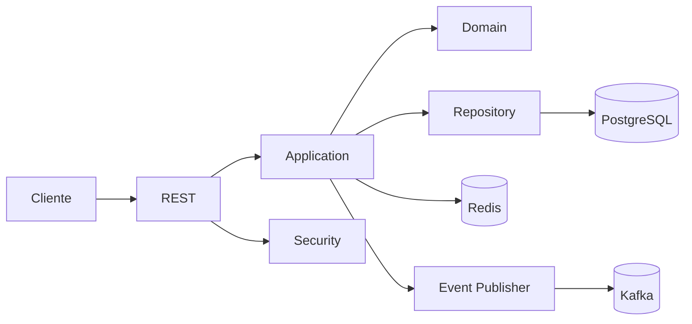

# Arquitetura

O projeto está separado por responsabilidade e contexto de negócio.

## Organização

`application` concentra os casos de uso.

`domain` tem as entidades, enums e contratos de repositório.

`infrastructure` concentra segurança, cache e mensageria.

`interfaces` concentra os controllers REST.

## Algumas escolhas

O projeto usa um monólito modular para manter a estrutura simples.

Redis é usado para cache de consulta de projeto.

Kafka é opcional. Quando estiver desabilitado, a aplicação usa um publisher vazio.
